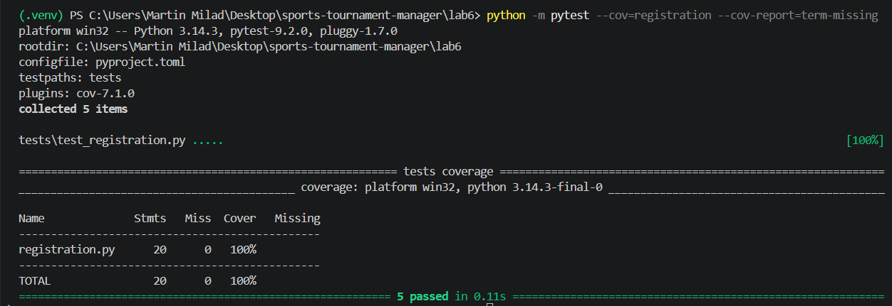
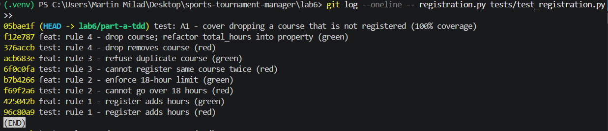
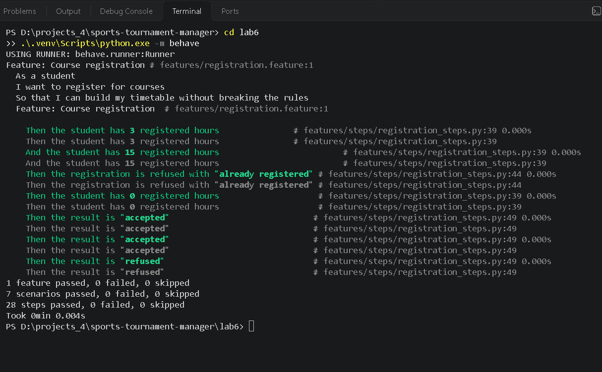
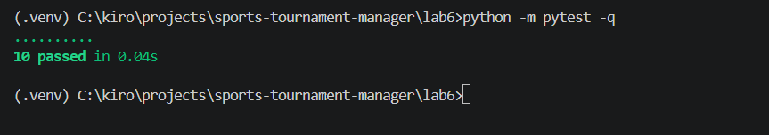
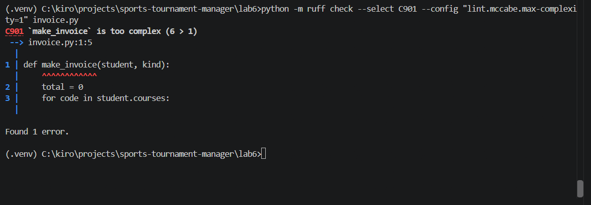
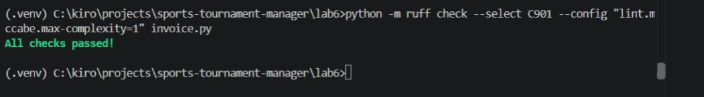
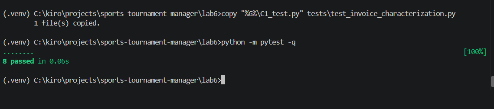

# Lab 6 - Part D: Documentation and Gherkin Scenarios 
 
## Team and Project 
- **Team:** Team Mavin (Group 2, Team 16) 
- **Project:** Sports Tournament Manager 
- **Role:** Product Owner (Nour Romany) 
 
## Gherkin Scenarios (US-01) 
See [part_d_us01_register_team.feature](./part_d_us01_register_team.feature) for the scenarios covering registering a team with a unique name, rejecting duplicate team names, and validating team name input. 
 
## Verification Screenshots 
-  
-  
-  
-  
-  
-  
-  
